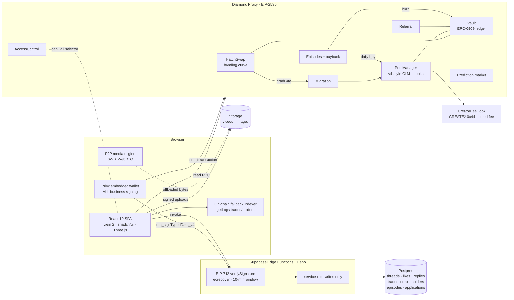
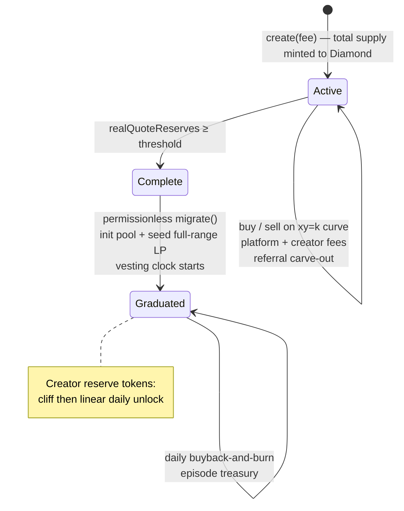
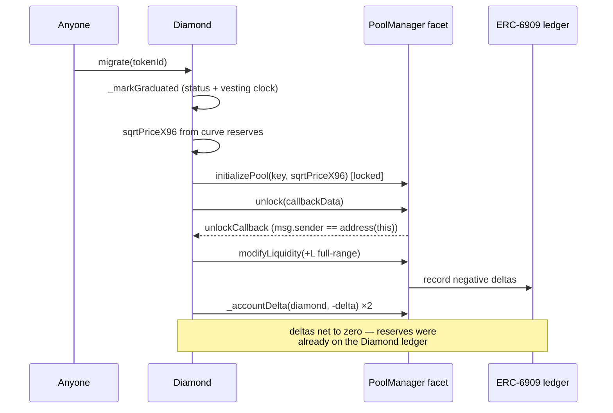
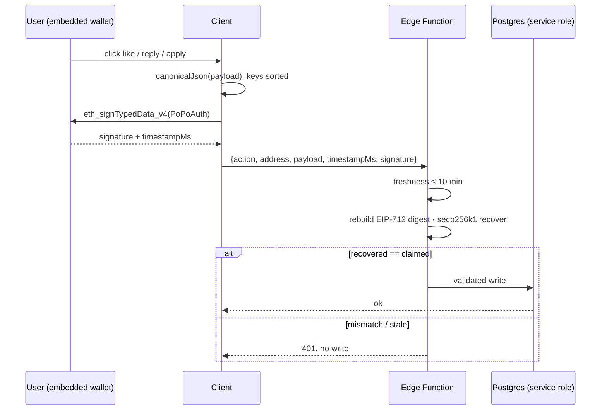
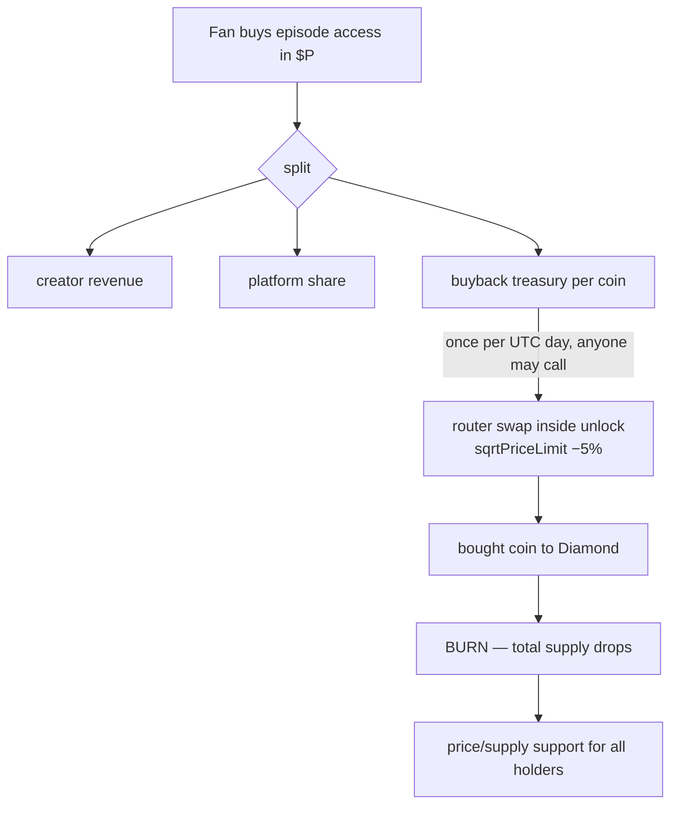

# Diagrams

Mermaid sources — render automatically on GitHub, or paste into
<https://mermaid.live>.

## 1. System overview

## 2. Token lifecycle

## 3. Flash accounting during migration

## 4. EIP-712 secured Supabase write

## 5. Episode buyback flywheel

